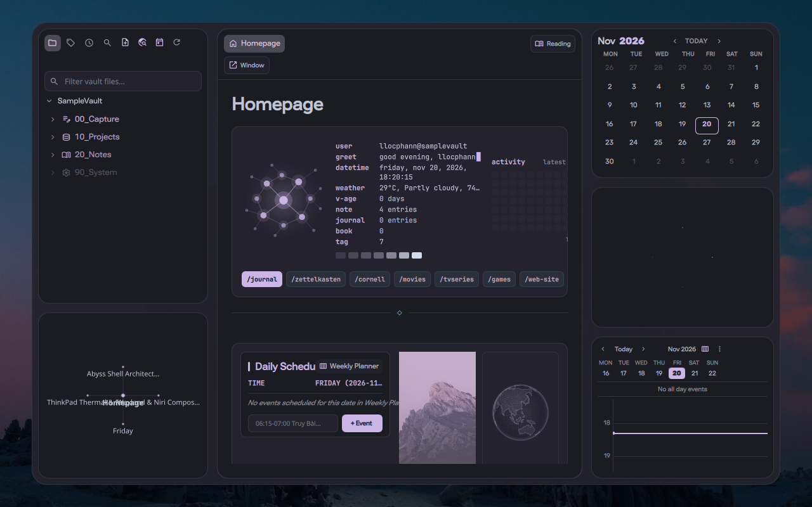
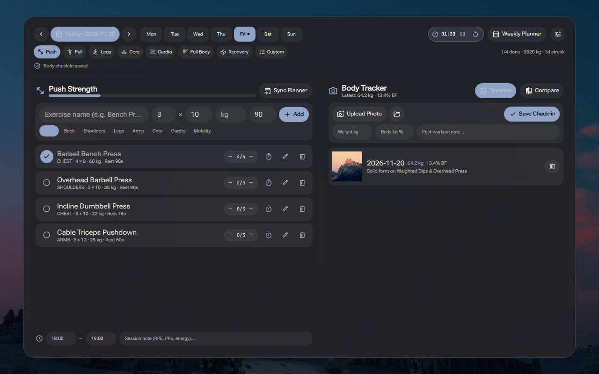

# Alis-Intergration

Optional workspace, study, fitness, and hardware integration plugins for the [**Alis**](https://github.com/llocphann/Alis) Wayland desktop shell (`hostApi: 1`). Every plugin is optional and disabled by default until you install and enable it.

## Included Plugins

### Nexus Knowledge Workspace (`nexus`)

Browse your Markdown vault inside Alis with an interactive file tree, folder-colored Canvas Mini-Graph, Homepage overview, Daily Schedule, Calendar & Today timeline, 3D Globe widget, Quicknotes, Todo sync, and adaptive Nexus Vault theming.

<p align="center">
  
</p>

### Spaced Repetition (`spaced_repetition`)

Review vocabulary directly on the Alis Dashboard with CEFR badges, morphology hints, Multiple Choice prompts, mastery bars, an Analytics donut, and a 7-day review forecast.

<p align="center">
  
</p>

### Exercises Tracker (`exercises_tracker`)

Track strength workouts and body metrics in clean borderless Dashboard cards synced with `Body Tracker` weight check-ins and configurable under **Alis Settings → Integrations**.

<p align="center">
  
</p>

### Hardware & Power (`tlp` · `thinkfan`)

- **TLP Power Management (`tlp`)** — Optional battery charge threshold and power profile controls for supported laptops.
- **Thinkfan Cooling (`thinkfan`)** — Optional managed fan-curve control and concise single-row status/toggle inside the System Monitor popup.

## Installation

Install all plugins into your user data directory from a clean git checkout without enabling any integration automatically:

```sh
python3 scripts/install.py install
```

Or manage individual plugins:

```sh
python3 scripts/install.py install-plugin nexus
python3 scripts/install.py remove-plugin nexus
python3 scripts/install.py uninstall
```

## Documentation & Links

- [Compatibility & Host Contract](docs/COMPATIBILITY.md) — host API boundary, saved preference guarantees, and safety defaults
- [Alis-Intergration GitHub Issues](https://github.com/llocphann/Alis-Intergration/issues) — active integration issues and milestones
- [Alis Core Shell](https://github.com/llocphann/Alis) — Wayland host shell (`dev` / `stable`)

---

- **License:** GPL-3.0-or-later; optional plugin isolation preserved.
- **Release Schedule:** Maintained alongside Alis `1.0.0` with updates released on a **quarterly, semi-annual, or annual** cadence.
